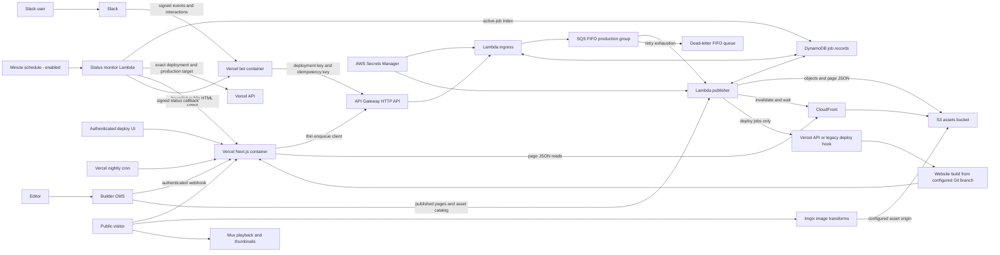
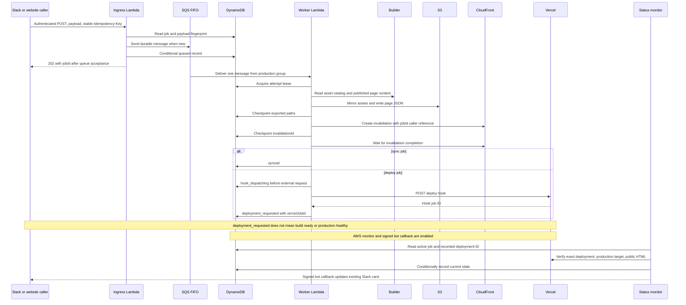
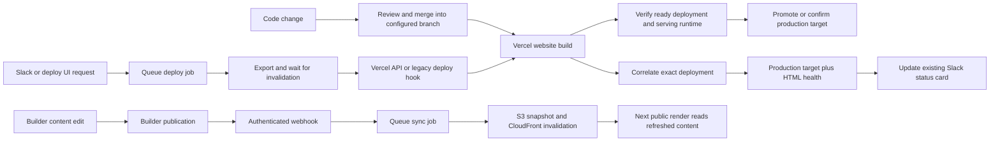
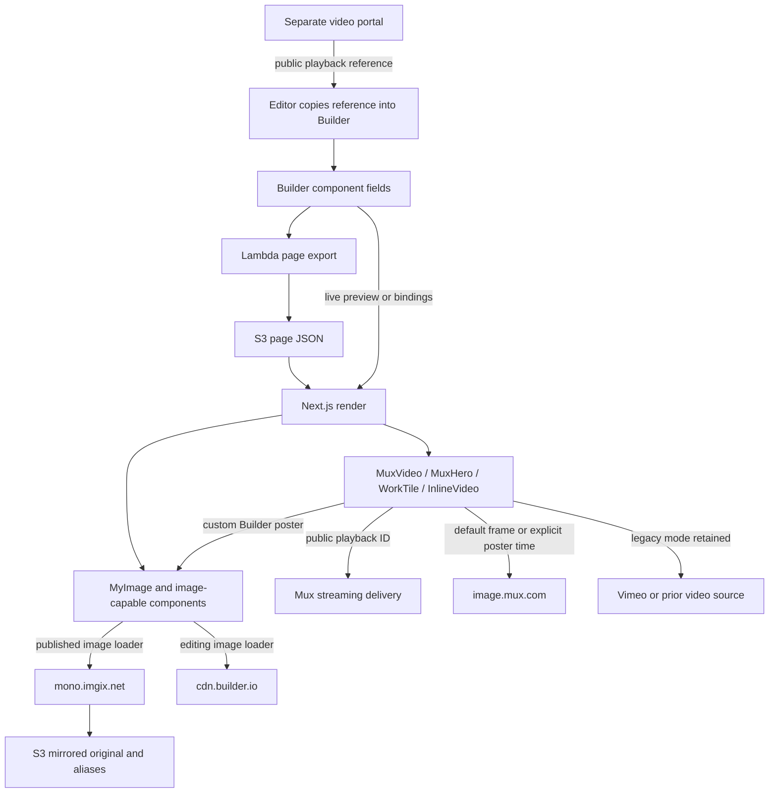

# MONO website and publishing architecture

Updated October 22, 2026. This document describes the migrated implementation and the verification completed during the Railway credential response. It supersedes the older [workspace architecture](../../ARCHITECTURE.md), which describes Next.js 14, website-local S3 exports, and fire-and-forget publishing. Historical media migration documents remain useful context, not proof of current provider state.

## Deployment status and verification boundary

The migrated website and Slack bot containers have now been promoted. The latest verified website deployment is `dpl_7a2HiCQx2Ck3HWBirD1wdGY3fk7G`; the bot deployment is `dpl_66mLa2KWTmC5qn2nFGPDQqwpRnsj`. Deployer PR 2, website PR 18, and bot PR 1 were merged. The AWS stack `mono-deployer-production` in `us-east-2` is `UPDATE_COMPLETE`, its functions are active, and both publishing gates are enabled.

Verified during this work:

- Actual serving Node version is **22.23.4** on both Vercel containers and AWS Lambda; build-time version alone was insufficient evidence.
- Website homepage, work/news pages, compiled JavaScript, redirects, and authentication checks passed. A signed Builder webhook for an unknown model returned a no-op response; it did not publish anything.
- The bot rejects unsigned Slack HTTP requests with 401. No real Slack publish submission was sent.
- An isolated full Lambda export covered 1,155 assets and 61 pages. The cold asset-copy run took approximately 652 seconds; a warm retry took approximately 118 seconds. These runs wrote a validation prefix, not production page objects, and did not invoke the Vercel deploy hook.
- AWS queue and dead-letter queue were empty at the final check; secrets were ready. The old AWS access key is inactive and its IAM principal was removed from the bucket policy.
- Recent error-log queries on the promoted website and bot returned no entries. This is a bounded observation, not a guarantee of future operation.

**A real production CMS export and end-to-end Slack-triggered deployment have not been exercised.** Normal production publishing is enabled, but acceptance, export completion, Vercel build completion, and successful production serving are distinct milestones.

## Status-card upgrade: live and dedicated rebuild verified

The credential/runtime migration and status-card upgrade are live. Bot PR 2 merged at `92617d0`; production deployment `dpl_66mLa2KWTmC5qn2nFGPDQqwpRnsj` is READY and serves patched Node 22.23.4. AWS is `UPDATE_COMPLETE` with `StatusEnabled=true`, so the one-minute monitor schedule is enabled.

Callback verification against the configured monitor hostname returned 401 unsigned and 404 for a correctly signed unknown-job callback: signature authentication passed, but no job/destination was found. No Slack messages were sent by those probes. A dedicated API rebuild verification was accepted as deployment `dpl_7a2HiCQx2Ck3HWBirD1wdGY3fk7G`, correlated to job `7af5c8688eb098b23ea58457abe189d37dc372b3bef1d7026a1fedf0f82654bf`. It completed **READY with production target**. The scheduled monitor independently recorded `status=live`, `phase=live`, and `monitorCheckedAt=1792699571`, then removed `monitorKey` from the completed job. This verifies the exact-deployment/production-alias/HTML-health path through the scheduled monitor. This dedicated test did not perform a CMS export or send a real Slack publishing submission.

The bot adds **Publish + rebuild** and **Sync content only**, creates one persistent Slack status card before enqueueing, and sends its validated channel/message coordinates with the request. Repeated submissions reuse the persisted target; a duplicate provisional card can be removed after reconciling the original. The card displays elapsed time, asset totals/completed/uploaded/reused/failed, page totals/completed, missing-asset warnings, and the cache-invalidation/build phase. Its **Check status** button reads the job API without starting another publish; **View deployment** links to the recorded deployment when available. Status request failures are not reported as publishing failure.

The worker's numeric-only progress callbacks report after enumeration and each processed item. Database updates are throttled to roughly five seconds, with final counters always attempted. Callback failures do not abort the export. Page completion counts processed pages, including entries skipped for having no routable URL; it is not an uploaded-object count.

[monitor.ts](../src/lambda/monitor.ts) adds a separate short-running Lambda scheduled approximately once per minute. It queries active jobs through DynamoDB's sparse `MonitorIndex` (`monitorKey=active`) rather than scanning all job history. Conditional writes compare the observed status and update timestamp so a stale monitor observation does not overwrite a newer worker state. Changed snapshots update the existing Slack card; unchanged snapshots do not produce repeated messages. Delivery failures retain monitoring state for retry. Terminal jobs leave the active index after notification is acknowledged, or immediately if there is no Slack destination. The schedule is controlled independently by `StatusEnabled`, initially false.

With `VERCEL_API_TOKEN` configured, the worker creates a production deployment through Vercel's API, passing the publishing job ID in `meta.publishingJobId` and recording the returned **exact deployment ID**. The monitor requires all of the following before reporting `live`:

1. Vercel returns that exact deployment ID, expected project ID, production target, and matching publishing-job metadata.
2. Its state is `READY`.
3. The project's actual production target points to that deployment ID, and the canonical `www.mono-1.com` alias belongs to the expected project and exact deployment, without a redirect or deletion marker.
4. The canonical website homepage returns a successful HTML response containing an HTML marker; redirects are rejected.
5. Both the production pointer and exact canonical alias are checked **again after the HTTP probe**, preventing a concurrent promotion from being mistaken for this job's successful release.

A ready but unpromoted deployment stays `ready` / `awaiting_promotion`; a failing homepage check stays pending. Provider/API errors are logged as tracking unavailable rather than invented success. Canceled/failed builds become `failed`; unresolved jobs older than 24 hours become `attention_required`. The HTML probe is a bounded availability check, not visual testing, asset coverage, or proof that every CMS page is correct. The legacy deploy-hook path remains compatible, but without an exact deployment ID the monitor cannot infer completion from a nearby build or a working homepage.

Notifications go to the bot's `/internal/publishing-status` endpoint using a separate HMAC-SHA256 signature over `timestamp + '.' + raw JSON body`. The bot uses `BOT_STATUS_SIGNING_SECRET`, rejects timestamps outside a five-minute window, caps bodies at 16 KiB, validates the destination and job fields, and updates the existing Slack message. This credential is distinct from Slack's own `SLACK_SIGNING_SECRET` and from the publishing ingress key. The callback carries only a status allowlist and destination, not Builder credentials, raw export paths, request fingerprints, or Vercel tokens.

**Tracking credentials:** the installed `mono-publishing-status` Vercel token was verified as scoped only to website project `mono-dotcom` (`prj_bsxsisiRxAzCsu5HcBMXMZ2Avwfv`). It is stored as `VERCEL_API_TOKEN` in `mono-deployer/production/vercel-automation` (`TrackingSecret`), readable by the worker and monitor. The monitor's secret permissions cover only `TrackingSecret` and the callback-signing `StatusSecret`; it cannot read the Builder private key in `PublishingSecret`. A mistakenly bot-scoped token was revoked.

The token expires **October 22, 2027 at 20:54 America/Chicago** (October 23 UTC). Renewal reminders were created for September 22 and October 15, 2027. Renew the website-scoped credential before expiry, replace the value in the tracking secret, and verify an authenticated read of the intended website project. Reminders do not rotate the token themselves. Expiration or permission failures must remain tracking errors, never a false “Published” result. Bot promotion, signed callback authentication checks, and `StatusEnabled` enablement are complete. The dedicated API rebuild and scheduled production-health verification succeeded; a real Slack-driven publish including a production CMS export remains the untested integrated path.

## Repository boundaries

Paths below assume the repositories retain their current sibling layout.

| Repository or directory | Responsibility | Start here |
| --- | --- | --- |
| `mono-deployer` | Authenticated publishing API, durable queue, export worker, AWS infrastructure | [README](../README.md), [SAM template](../infra/template.yaml), [ingress](../src/lambda/ingress.ts), [worker](../src/lambda/worker.ts) |
| `mono-dotcom` | Public Next.js 16.4.2 / React 19 website, Builder rendering, media components, thin publishing callers | [catch-all page](../../mono-dotcom/src/app/[[...slug]]/page.tsx), [publishing client](../../mono-dotcom/src/lib/publishing-client.ts), [security notes](../../mono-dotcom/docs/security-publishing-2026-10-22.md) |
| `mono-deploy-bot` | Slack interaction, confirmation password, enqueue request and truthful acceptance message | [Bolt app](../../mono-deploy-bot/index.js), [enqueue client](../../mono-deploy-bot/deploy-client.js), [runtime server](../../mono-deploy-bot/server.cjs) |
| `mono-dotcom-video-perf` | Separate Git worktree of the website repository, not an independent production service | Shares `mono-dotcom/.git`; do not treat it as an authoritative second deployment |
| `perf-check` | Local comparison/measurement scripts, not a service | [measurement script](../../perf-check/measure.mjs), [comparison script](../../perf-check/compare.zsh) |

The video portal is a separate application outside this sibling group. Website documentation records its repository as `/Users/grant.griffith/Documents/code/mono-video-portal` and its public address as `video-portal.mono-1.com`. Its authentication, catalog, migration ledger, archive jobs, and current infrastructure were not audited by this publishing migration. See the [video workflow](../../mono-dotcom/docs/video-migration-workflow.md) and [team portal guide](../../mono-dotcom/docs/team/video-portal/README.md).

## System map

Railway is no longer required for the migrated publishing execution path. The legacy Express entry point remains for local development; this statement does not assert that the Railway project has been deleted. Existing content serving does not require the publisher to be available: website code runs on Vercel and published snapshots/assets remain in S3/CloudFront, with Imgix and Mux serving their own media paths.

## Publishing entry points and authentication

| Entry point | Caller authentication | Enqueued work | Retry identity |
| --- | --- | --- | --- |
| Slack confirmation modal | Slack signing secret plus `DEPLOYMENT_PASSWORD` | `deploy`, all pages | Hash of workspace/enterprise, user, and modal view ID |
| Website `/api/deploy` | `x-deployment-key` against `DEPLOYMENT_KEY` | `deploy`, optional page ID | Supplied valid key or generated UUID |
| Website `/api/deploy/worker` | Same key; compatibility route only | Same queue request, no local worker | Supplied valid key or UUID |
| Website `/deploy` server action | Basic Auth independently checked in proxy and action | `deploy`, all pages | New UUID per submission |
| Builder `/api/webhooks/builder` | Separate `builder-webhook-secret` header | `sync` | Supplied key or SHA-256 of raw webhook body |
| `/api/cron/backfill-assets` | `Authorization: Bearer` using `CRON_SECRET` | `sync`, all pages | UTC date-based key |
| AWS `POST /api/deploy` | `x-deployment-key`, checked against Secrets Manager | Validated `sync` or `deploy`, optional page ID | Required `Idempotency-Key` |
| AWS `GET /api/jobs/{jobId}` | Same ingress authentication | Read-only job status | Job ID |

The nightly cron remains `0 6 * * *` (06:00 UTC), defined in the website's [Vercel configuration](../../mono-dotcom/vercel.json). Cron names are historical: the new path serializes a full sync through the publisher rather than doing an in-process asset repair.

The website validates that its enqueue destination is HTTPS on an API Gateway hostname and refuses redirects. The bot requires HTTPS without embedded credentials, query, or fragment and also refuses redirects. Neither caller needs an AWS access key, Builder private key, or Vercel deploy-hook URL.

The deployment UI and Slack say **queued**, not completed. The live migration baseline bot accepts HTTP 202 with a valid queued job response. A terminal duplicate from AWS is 409; the website translates recognized terminal duplicates into a truthful 200 status response. The live status-card bot also recognizes correlated 409 responses carrying the original Slack target and reconciles that existing card rather than claiming a fresh job.

Builder routing is in [publishing-client.ts](../../mono-dotcom/src/lib/publishing-client.ts): `page` syncs `newValue.id`; `news-tile`, `leadership-tile`, and `work-tile` map to fixed index-page IDs; `header`, `footer`, and `site` sync all pages. Unknown models return a no-op. Replacing index entries in Builder requires reviewing those mappings.

## Publish sequence and completion semantics

The ingress hashes the idempotency key into a 64-character job ID, and separately hashes `{mode,pageId}`. Reusing a key with a different payload is rejected. Queue delivery is the acceptance boundary; a database record alone is not enough. SQS deduplication and DynamoDB conditional writes handle repeated submissions, while the FIFO group serializes production publishing. All current jobs use the single `production` group, even though the worker has reserved concurrency of two.

## Code releases versus content publishing

A normal Builder webhook sync does not build website code. An explicit deploy request intentionally combines an export with a subsequent website build. Git-triggered builds and operator promotion are separate from content sync; inspect project configuration and the actual production target rather than assuming every ready build has been promoted.

## Durable job states and failure handling

```mermaid
stateDiagram-v2
  [*] --> queued: durable queue acceptance
  queued --> running: acquire attempt lease
  retry --> running: redelivery
  running --> retry: failure before deploy hook
  running --> synced: sync and invalidation completed
  running --> hook_dispatching: deploy mode, record intent
  hook_dispatching --> deployment_requested: Vercel returns job ID
  hook_dispatching --> hook_unknown: timeout, error, or interrupted dispatch
  deployment_requested --> building: scheduled monitor
  building --> ready: exact deployment READY
  ready --> live: exact target and alias checks around HTML probe
  building --> failed: ERROR or CANCELED
  ready --> failed: later failure or cancellation
  building --> attention_required: tracking unresolved after 24 hours
  live --> [*]
  failed --> [*]
  attention_required --> [*]
  synced --> [*]
  hook_unknown --> [*]: stop automatic retry; operator reconciliation
```

`validated` is also recognized as terminal for compatibility, but the direct validation path currently returns a result rather than creating a job record. A lease lasts 930 seconds; the worker timeout is 900 seconds. Retries reuse checkpointed paths and invalidation ID to avoid repeating completed export steps. The CloudFront caller reference is the job ID.

A failed pre-hook attempt sets `retry` and returns a partial batch failure. The queue has a 5,400-second visibility timeout, 14-day retention, and redrives after five receives. A stuck `running` attempt can be reclaimed after its lease expires. SQS visibility means retries may not be immediate. Job records expire through DynamoDB TTL after approximately 30 days; TTL removal is asynchronous. The table has point-in-time recovery and encryption enabled.

`hook_unknown` is deliberately terminal: a network timeout can occur after Vercel accepted the hook. Redriving that job blindly could create another deployment. Inspect Vercel build history and the job record before deciding whether to issue a genuinely new request. The live migration baseline has no automatic completion callback. The deployed monitor implementation described above adds exact deployment/production verification before reporting `live` with its schedule enabled; the worker still stops at request acceptance.

## Export format and S3 key contract

The [asset exporter](../src/lib/assets.ts) queries Builder's asset catalog with the private API credential, paginates it, and mirrors allowed assets. [Asset fetching](../src/lib/asset-fetch.ts) accepts only HTTPS `cdn.builder.io` URLs, rejects redirects and unsafe paths, imposes a 60-second deadline and 256 MiB size limit, and does not treat arbitrary page URLs as download targets.

The [page exporter](../src/lib/push-to-env.ts) fetches published pages in batches, optionally selects one page ID, expands referenced Symbol blocks, restores saved HTTP binding definitions rather than freezing hydrated SDK state, mirrors literal asset references, then writes JSON snapshots. Page routes map to `builder/pages/index.json` for `/`, and nested JSON paths for other routes. An authored `exportslug` can change the final filename; review it alongside the website URL mapping.

| Object family | Purpose |
| --- | --- |
| `builder/pages/...json` | Published page snapshots consumed by Next.js |
| `builder/...` canonical asset keys | Safe filenames/extensions inferred from path/type metadata |
| Original raw-path aliases under `builder/` | Preserve extensionless Builder URLs used by Imgix and content bindings |
| `builder/validation/<uuid>/...` | Isolated validation exports; never the production base URL |

Canonical and raw aliases are both important. The image loader can rewrite a Builder CDN pathname directly to Imgix without passing through page-JSON URL rewriting. Removing aliases would break those images even when a canonical file exists.

Asset-library failures stop publishing. A deleted upstream asset referenced only in page content is left at its original URL and reported through `missing_source_asset`, validation `missingAssets`, and job `missingAssetCount`; the exporter does not manufacture a nonexistent S3 link. This does not repair the missing image: editors still need to replace the reference. Assets already present can be skipped, so replacing bytes at a stable source URL needs explicit cache/origin investigation.

Exports update the production prefix **in place**, not as an atomic release. A mid-export error can leave some new objects alongside old ones. There is no automatic deletion of removed pages or orphan assets. S3 versioning is a recovery mechanism, not a transactional commit protocol. CloudFront invalidation currently covers the exported page paths; it is not an Imgix purge.

## Public rendering and Builder editing

The [catch-all page](../../mono-dotcom/src/app/[[...slug]]/page.tsx) is force-dynamic. With `STATIC_CONTENT_URL` configured and outside Builder editing, [get-content.ts](../../mono-dotcom/src/lib/get-content.ts) fetches page JSON from CloudFront using `cache: 'no-store'`. This disables Next's fetch cache for that read; CloudFront can still cache the object until invalidated.

Builder editing uses live Content API reads and Builder-aware search parameters so draft/preview content is not confused with a published snapshot. The public Builder key identifies the space and is intentionally usable in browser code; it does not grant the private management capabilities of `BUILDER_PRIVATE_KEY`.

Saved content bindings can remain live even inside exported pages. The website resolves those HTTP requests at render time. [content-binding-request.ts](../../mono-dotcom/src/lib/content-binding-request.ts) specifically keeps Work Tile data on Builder's short CDN cache (`cacheSeconds=30`, `staleCacheSeconds=30`) with no Next fetch cache. Therefore the snapshot architecture does not mean every byte of public content is independent of Builder availability.

## Images, video, and editorial media flow

[loaders.ts](../../mono-dotcom/src/lib/loaders.ts) chooses Builder images during editing, or whenever Imgix mode is disabled. Published Imgix URLs use `mono.imgix.net`, add the `/builder` prefix, preserve authored transforms, negotiate format, and set width/quality per image candidate. Imgix is a separate CDN/transformation layer; do not assume CloudFront invalidations invalidate Imgix variants. The configured Imgix origin relationship should be rechecked in the provider when changing storage or credentials.

Mux video is **not mirrored through the Builder asset exporter**. The browser plays from Mux using a public playback ID. [mux-reference.ts](../../mono-dotcom/src/lib/mux-reference.ts) parses either a bare playback ID or `mux:v1:...` with optional poster/start/end values. References contain portable public values, not access tokens, management asset IDs, or expiring download URLs. See the [reference contract](../../mono-dotcom/docs/mux-reference-contract.md).

[InlineVideo](../../mono-dotcom/src/components/InlineVideo/index.tsx) and [WorkTile](../../mono-dotcom/src/components/WorkTile/index.tsx) opt into Mux only when the boolean setting is true; old Vimeo/source fields are retained for rollback. [MuxVideo](../../mono-dotcom/src/components/MuxVideo/index.tsx) renders the player and optional encoding information; [MuxHero](../../mono-dotcom/src/components/MuxHero/index.tsx) adds hero behavior. Custom poster images override reference poster times; absent overrides follow Mux thumbnail defaults. Changes to a shared default poster can affect multiple placements, subject to browser/CDN caches.

The website's [playback-info endpoint](../../mono-dotcom/src/app/api/mux/playback-info/[playbackId]/route.ts) uses server-side Mux credentials to return only quality/resolution for ready public playback IDs. The management prototype endpoints for asset listing and uploads are disabled in production by [mux-editor-api.ts](../../mono-dotcom/src/lib/mux-editor-api.ts); the separately authenticated portal owns production media management. Do not reopen those prototype endpoints as part of a publishing fix.

## Cache and freshness boundaries

| Layer | Current behavior | What refreshes it |
| --- | --- | --- |
| Builder published content | Source of truth; live editing and some runtime bindings remain | Builder publishing and CDN policy |
| S3 pages and assets | Persistent objects; exporter writes current prefix | Export or explicit version recovery |
| CloudFront JSON | CDN in front of page objects | Worker waits for targeted page-path invalidation |
| Imgix images | Transformed variants over configured origin | Provider cache policy/purge or changed URL; separate from CloudFront |
| Next public page rendering | Force-dynamic; static JSON fetch uses no-store | Each render, subject to upstream CDN freshness |
| Work Tile bindings | Builder CDN 30-second freshness/stale settings; no Next fetch caching | Subsequent render and Builder CDN expiry |
| Mux metadata | Next unstable_cache, one hour; response max-age 300 / s-maxage 3600 | Cache expiry; container instances maintain separate local cache |
| Mux video/thumbnails | Mux delivery and browser caches | Provider policy, reference/default changes, cache expiry |
| Next optimized images | Ephemeral per-container cache | Cache miss, instance replacement; does not affect content authority |
| Compiled JS/CSS and browser public settings | Frozen into build output | New website build |

A content-only `sync` job does not request a Vercel rebuild. A `deploy` job does. Build time and serving latency are different measurements: the verified website container image took about 225 seconds to build, while the isolated publisher export took about 652 seconds with cold asset copies and 118 seconds on a warm retry. Neither is a promise of total publish time, which also includes queue delay, invalidation, and Vercel deployment.

## Secrets, roles, and trust boundaries

| Location | Names / capabilities |
| --- | --- |
| AWS ingress secret | Raw shared authentication value in `mono-deployer/production/ingress`; function receives `INGRESS_SECRET_ARN` |
| AWS tracking secret | `VERCEL_API_TOKEN` in `mono-deployer/production/vercel-automation`; worker and monitor receive `TRACKING_SECRET_ARN`; project-only scope and annual expiry described above |
| AWS status-signing secret | Separate HMAC credential in `mono-deployer/production/status-signing`; monitor receives `STATUS_SECRET_ARN`, bot uses `BOT_STATUS_SIGNING_SECRET` |
| AWS publishing secret | JSON containing `BUILDER_PRIVATE_KEY` and `VERCEL_DEPLOY_WEBHOOK`; worker receives `PUBLISHING_SECRET_ARN` |
| Website runtime | `DEPLOY_API_ENDPOINT`, `DEPLOYMENT_KEY`; separate `BUILDER_WEBHOOK_SECRET`, `CRON_SECRET`, `BASIC_AUTH_USER`, `BASIC_AUTH_PASSWORD`; Mux runtime credentials where used |
| Bot runtime | `SLACK_BOT_TOKEN`, `SLACK_SIGNING_SECRET`, `DEPLOYMENT_PASSWORD`, `DEPLOY_API_ENDPOINT`, `DEPLOYMENT_KEY`; local Socket Mode additionally uses `SLACK_APP_TOKEN` |
| Public website build configuration | Public Builder space key, GTM container ID, boolean tracking/image settings, public CloudFront content base; explicit allowlist in [build script](../../mono-dotcom/scripts/build-container.mjs) |
| Offline operator tools | May require separate Builder/Mux/Vimeo or AWS credentials for their explicit task; not website runtime dependencies |

The four retired website variables `AWS_ACCESS_KEY_ID`, `AWS_SECRET_ACCESS_KEY`, `BUILDER_PRIVATE_KEY`, and `VERCEL_DEPLOY_WEBHOOK` were removed from all website provider environments during cutover. Do not restore them for convenience. Local ignored env files and historical deployment snapshots require separate lifecycle care; removal from current project settings is not deletion of every historical copy.

The ingress role can send to its queue, read/write job records as needed, and read only its ingress secret. The worker role can consume that queue, update job state, read its publishing secret, read/write `builder/*`, list the bucket for missing-object checks, and create/read invalidations on the configured distribution. It does not need a long-lived AWS access key. S3 deletion and bucket administration are not worker permissions. Review [template.yaml](../infra/template.yaml) when adding a capability rather than widening IAM speculatively.

## Temporary patched runtimes

Managed probes returned older Node patches despite patched build environments. The current temporary solution pins official Node 22.23.4 in both [website Dockerfile](../../mono-dotcom/Dockerfile.vercel) and [bot Dockerfile](../../mono-deploy-bot/Dockerfile.vercel), including immutable image digest. Vercel container services are explicit in each `vercel.json`; website Fluid Compute is enabled. Next standalone includes `public` and `.next/static`, preserves redirects/proxy/API routes, and runs as the `node` user.

Website container build variables were not forwarded through Docker ARGs in testing. The committed [public build configuration](../../mono-dotcom/config/public-build-env.json) contains only the allowlisted public identifiers/settings; runtime credentials are injected separately. `.dockerignore` excludes env files and local artifacts. Update public build configuration deliberately when those identifiers change.

AWS uses a checksum-verified official ARM64 interpreter layer built by [build-node-runtime.py](../scripts/build-node-runtime.py), with `AWS_LAMBDA_EXEC_WRAPPER` pointing to the wrapper. Both handlers enforce the minimum patched Node version. AWS automatic managed-runtime updates do not replace that pinned interpreter. Vercel image pins and the AWS layer therefore need deliberate updates for future security releases.

To return to managed hosting later, first prove the **actual serving runtime** meets the patch gate. Remove only container-specific files/configuration and public-build shim; keep queue clients, auth fixes, SDK upgrades, and secret separation. Do not downgrade the security requirement merely because `engines` or build logs look correct.

## Operations and recovery

1. **Start with a job ID.** Query the authenticated job-status API or inspect its DynamoDB record and worker logs. Correlate `vercelJobId` separately when state is `deployment_requested`. Avoid printing secrets or entire provider configuration.
2. **Distinguish paused acceptance from paused consumption.** `PublishEnabled` controls application acceptance/execution; `WorkerEnabled` controls the SQS event source. Coordinate both when stopping publishing. Disabling consumption leaves durable queued work; disabling only application execution can cause failures on delivery.
3. **Before the hook:** inspect the export failure, permissions, upstream availability, missing assets, and invalidation checkpoint. Reuse the original logical request/key when appropriate. DLQ redrive is a deliberate recovery action after fixing the cause, not an automatic cleanup step.
4. **After uncertain hook dispatch:** do not blindly retry. Reconcile Vercel build history with the recorded job and timestamps. A failed website build does not imply the content export failed, and a successful content export does not prove the website build succeeded.
5. **Recover content carefully.** Inspect S3 object versions before restoring; account for partial in-place updates. Restore the intended object versions and invalidate corresponding CloudFront paths. Review Imgix separately for image issues. Do not purge or delete the whole bucket as a repair shortcut.
6. **Validate without production publishing.** An IAM-authorized `{"healthcheck":true}` invocation reports runtime/secret readiness. `{"validate":true}` writes an isolated UUID prefix and returns counts, missing assets, and elapsed time without invoking Vercel or production invalidation. Reuse a recorded validation UUID only when intentionally inspecting/retrying that isolated run. Validation writes storage and may require later cleanup by an operator.
7. **Watch the correct alarms.** DLQ and Lambda Errors alarms exist; `AlarmTopicArn` must point to an existing notification destination to deliver notifications. Caught partial-batch failures may not increment Lambda Errors, so monitor queue depth, age, DLQ, and structured job logs as well. CloudWatch log retention is 30 days.
8. **Rotate at the issuer and update consumers.** Coordinate ingress secret changes with website/bot deployment environments; Builder webhook auth is separate. Replace Builder private credentials and Vercel hooks at their issuing services, then update Secrets Manager. Never place fresh secrets in Railway or commit them to the repositories.
9. **Release code and hosting together.** Keep the deploy hook's configured Git branch on the migrated source. Stage with `--prod --skip-domain`, inspect runtime and behavior, then promote the verified deployment. A ready automatic Git build is not proof it is the production target; inspect deployment/alias state.

## Agent and maintainer entry points

| Task | Source/tests to inspect first |
| --- | --- |
| Acceptance, authentication, idempotency | [ingress](../src/lambda/ingress.ts), [common helpers](../src/lambda/common.ts), [Lambda tests](../test/lambda.test.cjs) |
| Retry/checkpoint/hook behavior | [worker](../src/lambda/worker.ts), [infrastructure](../infra/template.yaml) |
| Asset naming, aliases, safe downloads | [assets](../src/lib/assets.ts), [asset fetch](../src/lib/asset-fetch.ts), [export tests](../test/export.test.cjs) |
| Snapshot format, symbols, bindings | [page exporter](../src/lib/push-to-env.ts), [website content reader](../../mono-dotcom/src/lib/get-content.ts) |
| Website publishing entry points | [publishing client](../../mono-dotcom/src/lib/publishing-client.ts), [server action](../../mono-dotcom/src/components/Deployment/actions.ts), [client tests](../../mono-dotcom/tests/publishing-client.test.ts) |
| Slack behavior and retry semantics | [bot app](../../mono-deploy-bot/index.js), [deploy client](../../mono-deploy-bot/deploy-client.js), [bot README](../../mono-deploy-bot/README.md) |
| Media playback and editor compatibility | [reference contract](../../mono-dotcom/docs/mux-reference-contract.md), [Mux parser](../../mono-dotcom/src/lib/mux-reference.ts), [image loaders](../../mono-dotcom/src/lib/loaders.ts) |
| Media migration or archive work | [video migration workflow](../../mono-dotcom/docs/video-migration-workflow.md), [script guide](../../mono-dotcom/scripts/README.md); treat private reports as sensitive |
| Status-card upgrade | [monitor](../src/lambda/monitor.ts), [bot card/signature handler](../../mono-deploy-bot/publishing-status.js), [Lambda behavior tests](../test/lambda.test.cjs); keep `StatusEnabled=false` until callback and scoped secrets are ready |
| Runtime packaging | [Lambda bundler](../scripts/build-lambda.cjs), [runtime layer builder](../scripts/build-node-runtime.py), both Dockerfiles, website public-build shim |

Use each repository's pinned Node/package-manager versions and frozen lockfile. The deployer README gives `pnpm test` and `pnpm build:lambda`; website tests and TypeScript checks are separate; bot tests mock network interactions. Do not exercise real Slack publishing, Builder writes, Vercel hooks, or S3 recovery simply to run a unit test. The legacy Express entry point and website offline export utilities are not substitutes for the production queue and have different locking/credential assumptions.

Cross-repository links in this document work in the local sibling checkout; GitHub views of this single repository cannot necessarily resolve another private repository through `../../`. Follow the named repository and relative source path when reviewing remotely.
